# pi-mom-slack

Run the [pi coding agent](https://github.com/earendil-works/pi-mono) in Slack. Mention it in a channel or write to it directly: each Slack thread gets its own pi session and its own working directory, kept across restarts.

```sh
npx pi-mom-slack
```

<p align="center">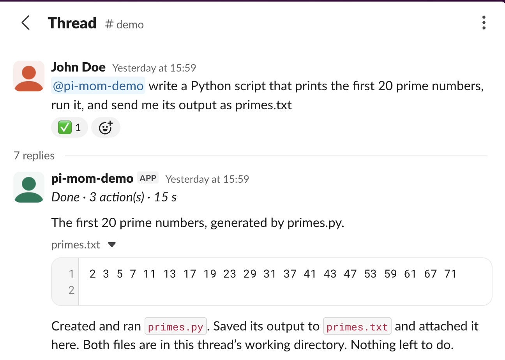</p>

Inspired by `mom`, the Slack bot removed from pi-mono on 30 April 2026. Its last release, `@mariozechner/pi-mom` 0.70.6, is still on npm but tied to the pre-1.0 pi under the old `@mariozechner` scope. Not affiliated with Earendil.

## What you get

- **One pi session per thread.** Follow-ups in the thread keep the context, even after the bot restarts.
- **Mentions, direct messages, and plain replies** in a thread the bot already answers.
- **Files both ways.** Attachments land in the thread's working directory (images go to the model when it reads them); the agent sends files back with its `slack_upload` tool.
- **Visible progress.** 👀 on your message, a status line updated as tools run, then ✅ or ⚠️.
- **Commands:** `!stop`, `!status`, `!model`, `!help`.
- **Robust by default.** A run cut by a restart resumes on its own (at most twice), a Slack connection that stays down makes the process exit for its supervisor to restart it, the startup message says why the bot restarted, the agent's shell never sees the Slack tokens or other credentials, and a second process on the same app is detected.
- **Your pi, as configured.** Model, credentials and skills come from `~/.pi/agent/`, like `pi` in your terminal.

## Setup (5 minutes)

You need Node.js 22.19 or later, and pi set up on the machine that runs the bot: run `npx @earendil-works/pi-coding-agent` once and log in with `/login` (or set your provider's API key).

### 1. Create the Slack app

**[Create the app from the manifest](https://api.slack.com/apps?new_app=1&manifest_json=%7B%22display_information%22%3A%7B%22name%22%3A%22pi%22%2C%22description%22%3A%22pi%20coding%20agent%20in%20Slack%22%7D%2C%22features%22%3A%7B%22app_home%22%3A%7B%22home_tab_enabled%22%3Afalse%2C%22messages_tab_enabled%22%3Atrue%2C%22messages_tab_read_only_enabled%22%3Afalse%7D%2C%22bot_user%22%3A%7B%22display_name%22%3A%22pi%22%2C%22always_online%22%3Atrue%7D%7D%2C%22oauth_config%22%3A%7B%22scopes%22%3A%7B%22bot%22%3A%5B%22app_mentions%3Aread%22%2C%22chat%3Awrite%22%2C%22channels%3Ahistory%22%2C%22groups%3Ahistory%22%2C%22im%3Ahistory%22%2C%22im%3Aread%22%2C%22im%3Awrite%22%2C%22files%3Aread%22%2C%22files%3Awrite%22%2C%22reactions%3Awrite%22%2C%22users%3Aread%22%5D%7D%7D%2C%22settings%22%3A%7B%22event_subscriptions%22%3A%7B%22bot_events%22%3A%5B%22app_mention%22%2C%22message.channels%22%2C%22message.groups%22%2C%22message.im%22%5D%7D%2C%22interactivity%22%3A%7B%22is_enabled%22%3Afalse%7D%2C%22org_deploy_enabled%22%3Afalse%2C%22socket_mode_enabled%22%3Atrue%2C%22token_rotation_enabled%22%3Afalse%7D%7D)** (opens Slack with everything filled in), pick your workspace, click **Next**, review, and click **Create**.

Or by hand: [api.slack.com/apps](https://api.slack.com/apps) → **Create New App** → **From a manifest** → paste [`manifest.json`](manifest.json).

<p>
  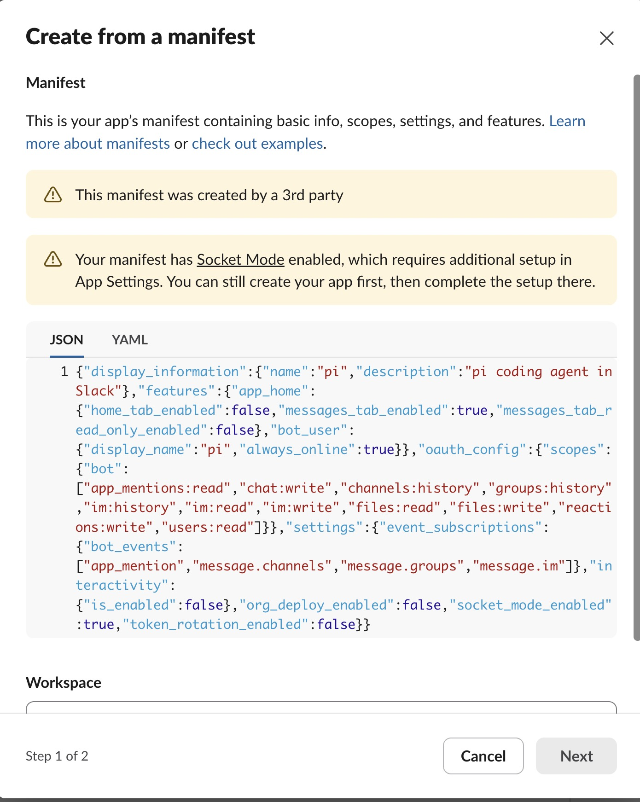
  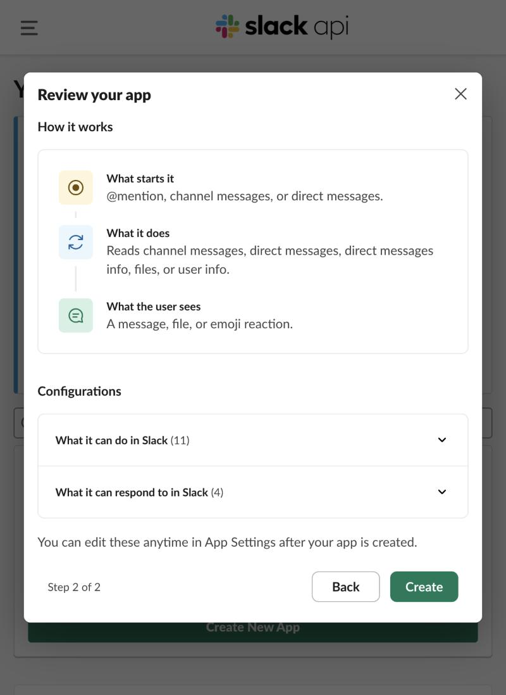
</p>

### 2. Get the two tokens

- **App token (`xapp-…`)**: **Basic Information** → **App-Level Tokens** → **Generate Token and Scopes**, any name, scope `connections:write`.
- **Bot token (`xoxb-…`)**: **Install App** → **Install to Workspace** → allow, then copy the **Bot User OAuth Token**.

<details>
<summary>Screenshots</summary>

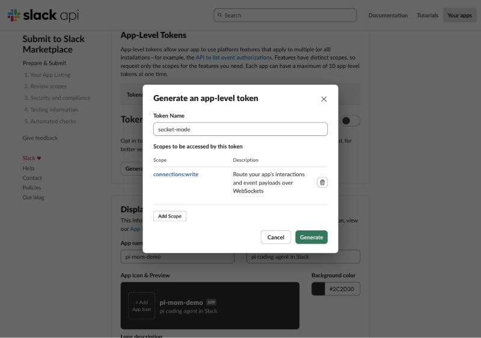

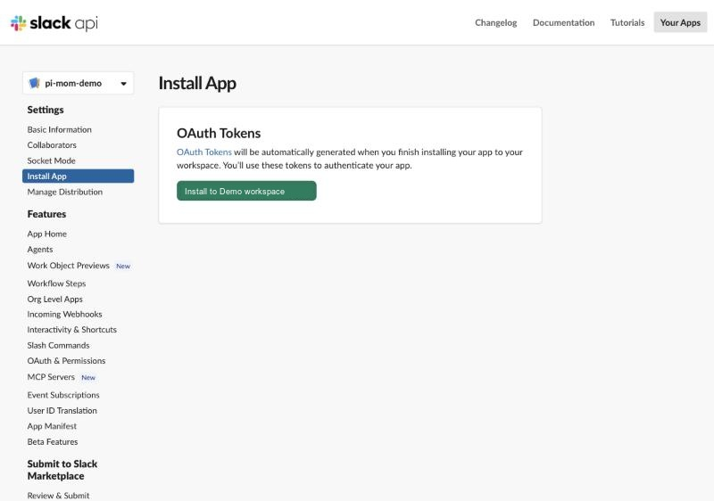

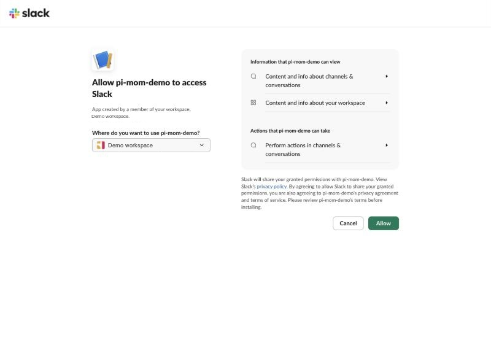

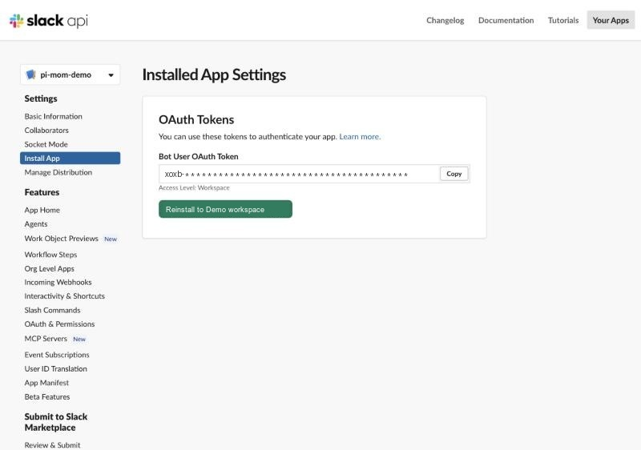

</details>

### 3. Find your Slack member ID

In Slack: your profile → **⋯** → **Copy member ID** (it looks like `U012ABCDEF`). Only the IDs you list can talk to the bot.

<details>
<summary>Screenshot</summary>

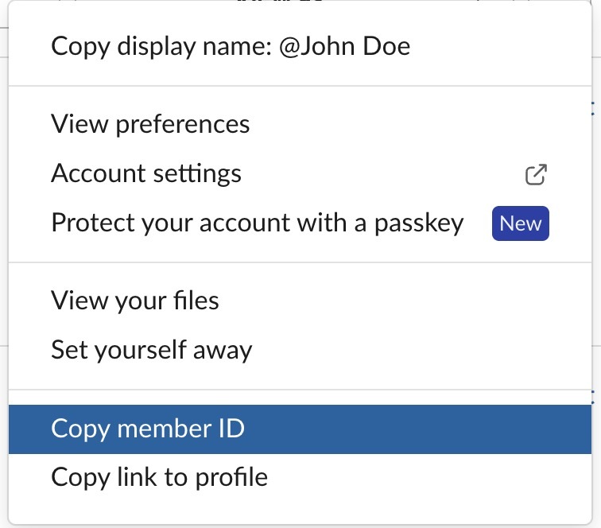

</details>

### 4. Run it

Create a `.env` file where you run the bot:

```sh
SLACK_APP_TOKEN=xapp-…
SLACK_BOT_TOKEN=xoxb-…
PI_SLACK_ALLOWED_USERS=U012ABCDEF,U034GHIJKL
```

Then:

```sh
npx pi-mom-slack
```

The bot sends you a direct message when it is up. In a channel, invite it with `/invite @pi` (the name you gave the app; the screenshots use `pi-mom-demo`), then mention it: `@pi write a script that…`. In a direct message, just write.

<details>
<summary>Screenshots</summary>

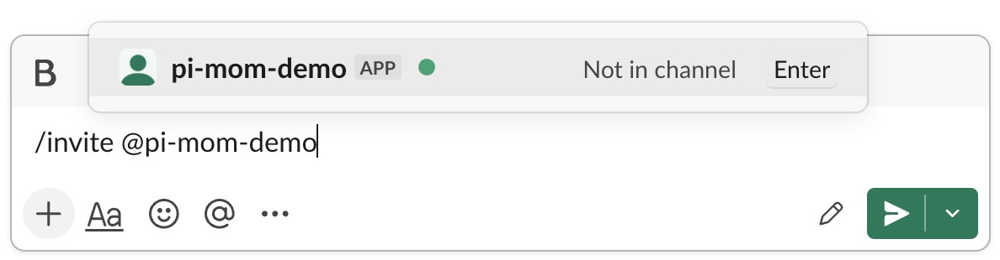

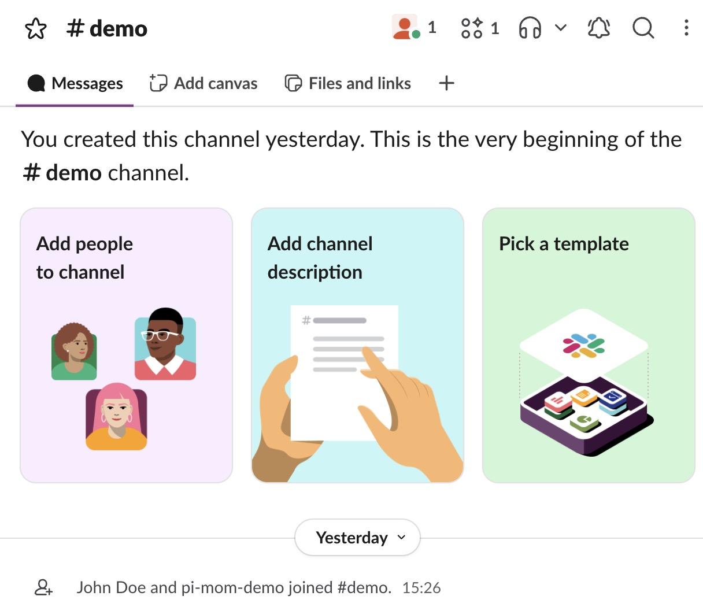

</details>

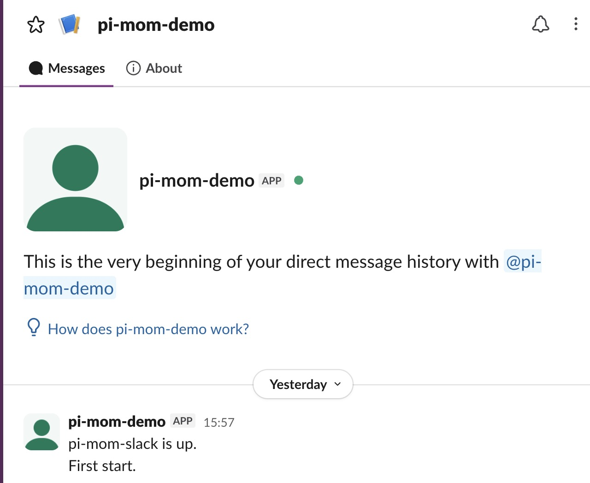

## Using it

| You do | The bot |
|---|---|
| `@pi <request>` in a channel | starts a thread with its own pi session |
| reply in that thread | continues the same session, no mention needed |
| write to it directly | answers in a thread under your message; reply there to continue |
| attach files | saves them in the thread's working directory under `files/` |
| `!stop` | stops the current run |
| `!status` | idle or running (who, for how long), model, working directory |
| `!model` | lists the models you have credentials for |
| `!model sonnet` | switches this thread's model (exact `provider/id` or a unique part of it) |
| `!model default sonnet` | also changes pi's default model |
| `!help` | lists the commands |

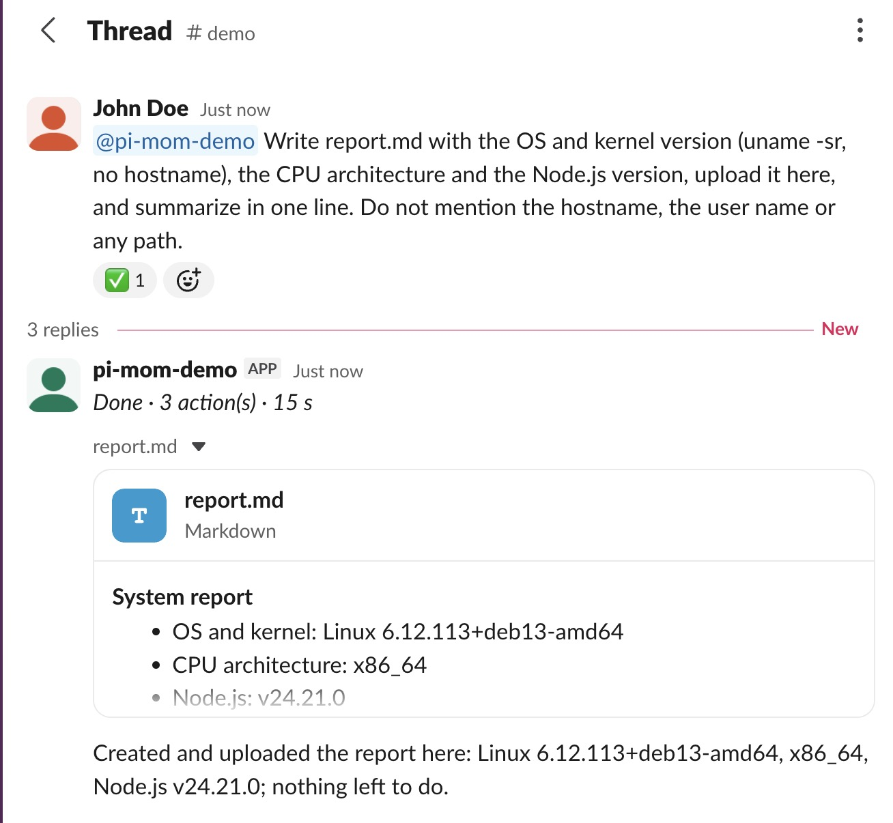
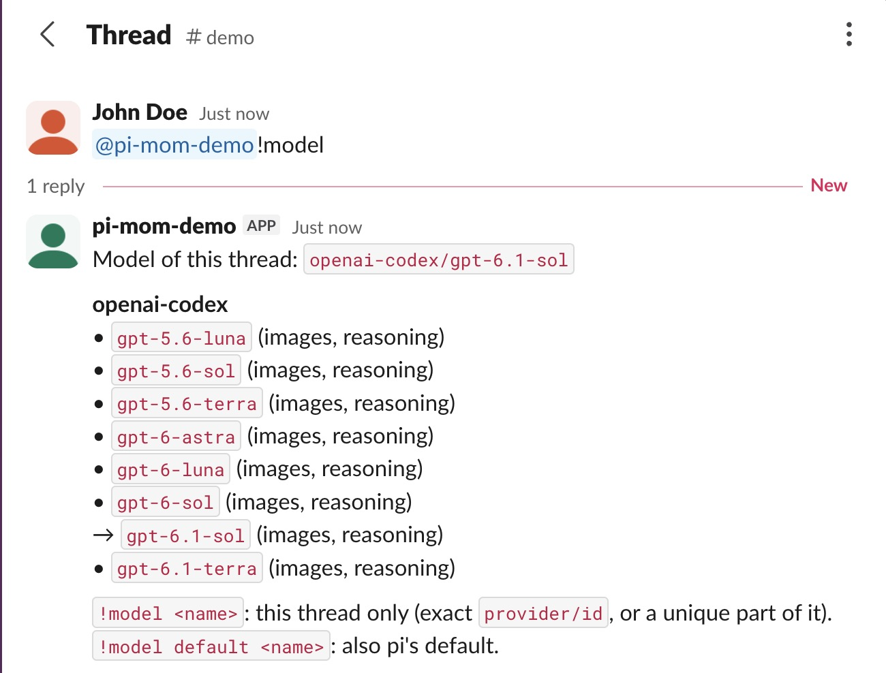

## Configuration

| Variable | Default | |
|---|---|---|
| `SLACK_APP_TOKEN` | required | app-level token, `xapp-…` |
| `SLACK_BOT_TOKEN` | required | bot token, `xoxb-…` |
| `PI_SLACK_ALLOWED_USERS` | required | Slack member IDs, comma separated |
| `PI_SLACK_DATA_DIR` | `~/.pi/slack` | thread working directories, run markers, state |
| `PI_SLACK_ENV_FILE` | `./.env` | file read for the variables above |
| `PI_SLACK_DEBUG` | | logs the type of each Slack event |
| `PI_SLACK_SOCKET_DOWN_LIMIT_MS` | `180000` | if the Slack connection stays down this long, the process exits so a supervisor restarts it |

Variables already set in the environment win over the file. Everything read from the file, plus any variable whose name looks like a credential (`TOKEN`, `SECRET`, `API_KEY`, `PASSWORD`…), is removed from the environment of the agent's shell. pi itself still reads your provider keys.

The model, thinking level, skills and context files (`AGENTS.md`) come from pi's own configuration. pi extensions are not loaded, since many expect a terminal.

## Running it as a service

Keep **one** process per Slack app: Slack spreads events across connections at random, so a second process with the same tokens silently takes some messages. The bot warns you in a direct message when it sees more than one connection.

On a server you reach over SSH, from the folder that holds your `.env`:

```sh
scripts/deploy-ssh.sh my-server        # sends this commit, builds, copies .env, starts a user systemd service
ssh my-server journalctl --user -u pi-mom-slack -f
```

The server needs Node.js 22.19+, pi logged in, and linger for your user (`sudo loginctl enable-linger $USER`, once), so the service keeps running after you log out. It needs no GitHub access. Run the script again to update.

Or write the user systemd unit yourself, for example:

```ini
# ~/.config/systemd/user/pi-mom-slack.service
[Unit]
Description=pi in Slack
After=network-online.target

[Service]
WorkingDirectory=%h/pi-slack
ExecStart=/usr/bin/env npx --yes pi-mom-slack@0.1.1
Restart=on-failure

[Install]
WantedBy=default.target
```

```sh
systemctl --user enable --now pi-mom-slack
sudo loginctl enable-linger $USER   # keep it running after logout
```

Pin the version and update it on purpose: the startup message lists what changed. `pi-mom-slack@latest` also works, but then every restart may run a release you have not read, including the automatic pi updates. Under systemd, `npx` must be on the unit's `PATH` (with nvm, set `Environment=PATH=…` to nvm's `bin` folder), or use `scripts/deploy-ssh.sh`, which does it for you.

## Compared with mom

pi-mom-slack is not a port of mom. It keeps the idea (pi in Slack, one command) and builds on the current pi SDK.

| | mom 0.70.6 | pi-mom-slack |
|---|---|---|
| pi | own tools on pi 0.70 (`@mariozechner`) | pi's SDK and tools, `@earendil-works` 1.x, updated with pi |
| Conversation unit | one context per channel, with the channel log | one pi session per thread |
| Configuration | its own folder (`~/.pi/mom/`) | your pi: model, credentials, skills, `AGENTS.md` |
| Sandbox | Docker mode | runs as the bot's user; use a dedicated user or a container |
| Scheduled events | yes (one-shot, periodic, immediate) | not yet |
| Memory files | `MEMORY.md`, global and per channel | pi's context files |
| Commands | | `!stop`, `!status`, `!model`, `!help` |
| Extending | | `customTools`, `commands`, `hooks` |

## Security

The agent runs pi's tools, `bash` included, as the user running the bot, on that machine. Treat access to the bot like shell access: list only people you would give a shell to, and run it under a dedicated user or in a container if the machine holds anything sensitive. Removing credentials from the agent's shell prevents mistakes, not a determined agent.

## Extending it

The package is also a library. `createSlackBot` takes the same settings as the CLI, plus extension points:

```ts
import { defineTool } from "@earendil-works/pi-coding-agent";
import { Type } from "typebox";
import { configFromEnv, createSlackBot } from "pi-mom-slack";

const bot = createSlackBot({
  ...configFromEnv(),              // tokens, allowed users, data dir (or pass them yourself)
  systemNote: "You work for the data team. Answer in English.",
  customTools: (thread) => [       // extra pi tools, built per thread
    defineTool({
      name: "deploy_preview",
      label: "Deploy a preview",
      description: "Deploy the working directory as a preview.",
      parameters: Type.Object({}),
      execute: async () => ({ content: [{ type: "text", text: await deploy(thread.workspace) }], details: {} }),
    }),
  ],
  commands: {                      // !version in a thread
    version: () => "build 42",
  },
  hooks: {
    beforeRun: ({ text, user }) => text,           // return a string to change what the model receives
    afterRun: ({ thread }, result, error) => {},   // after each run, successful or not
    onStart: ({ reason }) => {},                   // once connected
  },
});

await bot.start();
// later: await bot.stop("SIGTERM");
```

`thread` gives `key`, `channel`, `threadTs`, `workspace`, and `post(text)` / `upload(file, name)` for the thread. A complete example: [`examples/custom-bot.ts`](examples/custom-bot.ts).

## Staying current with pi

A daily GitHub Action checks for a new pi release. When the tests pass with it, a new patch version of pi-mom-slack is published; when they fail, pi itself is asked to fix the code and the fix arrives as a pull request reviewed by a human. Nothing is published without green tests. See [`.github/workflows/release.yml`](.github/workflows/release.yml). For a fork: set the `OPENROUTER_API_KEY` secret (and optionally a `PI_MODEL` variable, `provider/model`), and configure npm trusted publishing for `release.yml`.

## Development

```sh
npm install
npm test        # no network: Slack is faked, pi runs against a local scripted model
npm run check
npm start       # runs src/cli.ts directly
```

## License

MIT
